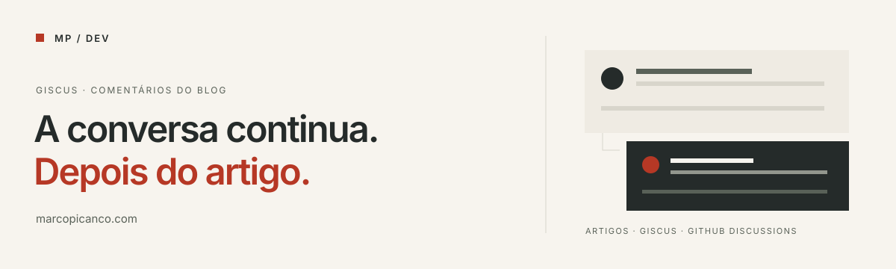
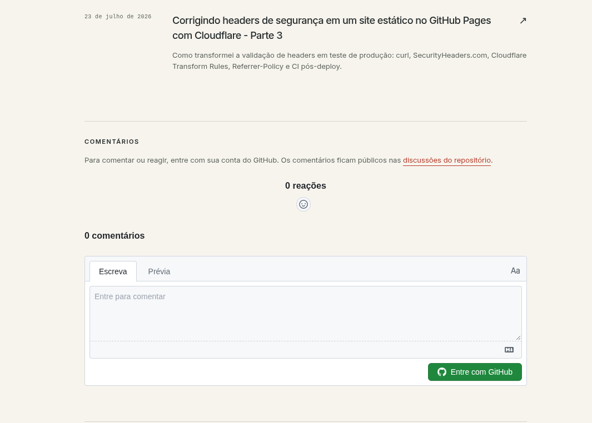
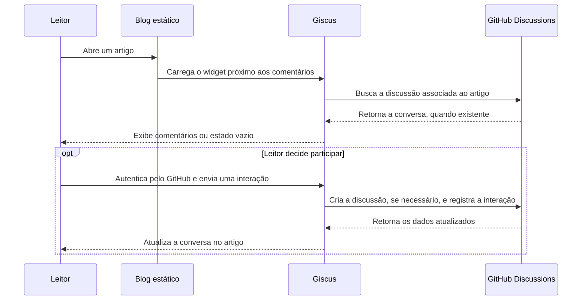

# Comentários do blog com Giscus

As discussões dos artigos de **[marcopicanco.com](https://www.marcopicanco.com/blog/)** ficam neste repositório. O [Giscus](https://giscus.app/pt) apresenta essas conversas dentro do blog e utiliza o GitHub Discussions para armazenar comentários e reações.

O site continua estático, publicado no GitHub Pages. A participação dos leitores acontece pelo Giscus e pelo GitHub, sem exigir uma API de comentários ou um banco de dados administrado pelo autor.

**[Ler o blog](https://www.marcopicanco.com/blog/)** · **[Abrir discussões](https://github.com/marcopicanco-dev/giscus/discussions)** · **[Conhecer o projeto oficial](https://github.com/giscus/giscus)**

> Este repositório é a base de discussões do blog e documenta sua integração. O desenvolvimento da aplicação Giscus acontece em [giscus/giscus](https://github.com/giscus/giscus).

## Neste README

- [Como aparece abaixo dos artigos](#como-aparece-abaixo-dos-artigos)
- [Como funciona](#como-funciona)
- [Configuração utilizada no blog](#configuração-utilizada-no-blog)
- [Como adicionar a outro blog](#como-adicionar-a-outro-blog)
- [Integração com Astro e outros geradores](#integração-com-astro-e-outros-geradores)
- [Identidade visual e temas](#identidade-visual-e-temas)
- [CSP e Cloudflare](#csp-e-cloudflare)
- [Benefícios, limitações e decisões](#benefícios-limitações-e-decisões)
- [Moderação e manutenção](#moderação-e-manutenção)
- [Problemas comuns](#problemas-comuns)
- [Checklist de validação](#checklist-de-validação)
- [Referências](#referências)

## Como aparece abaixo dos artigos



*Captura fornecida por Marco Picanço. O widget aparece no estado sem autenticação, com zero comentários e zero reações.*

Na estrutura atual do blog, a seção fica **depois do conteúdo, da navegação da série e dos artigos relacionados**, quando essas seções existem, e antes do rodapé de navegação do post.

A interface reúne:

- O título **Comentários** e um aviso de que as mensagens ficam públicas no GitHub.
- Um link para as discussões deste repositório.
- As reações à publicação e a lista de comentários.
- O formulário de escrita, a prévia e o botão **Entre com GitHub**.

O leitor pode visualizar as conversas públicas sem se autenticar. Para publicar comentários e reações pelo widget, precisa entrar com sua conta GitHub e autorizar o aplicativo no fluxo apresentado.

O estado vazio da captura é esperado: não é necessário criar manualmente uma discussão para cada artigo. Se ainda não existir uma conversa correspondente, o Giscus pode criá-la na primeira interação de comentário ou reação.

**Exemplo no site:** [artigo sobre headers de segurança — parte 3](https://www.marcopicanco.com/2026-07-23-corrigindo-headers-de-seguranca-em-um-site-estatico-no-github-pages-com-cloudflare-parte-3/).

## Como funciona



Cada parte tem uma responsabilidade:

| Parte | Responsabilidade |
| --- | --- |
| Astro e GitHub Pages | Gerar e publicar os artigos e o espaço onde o widget será inserido |
| Giscus | Localizar a discussão e apresentar a interface de participação em um iframe |
| GitHub Discussions | Persistir as conversas, associá-las às contas e oferecer ferramentas de moderação |
| Este repositório | Reunir as discussões utilizadas pelo blog |

Os comentários ficam nos dados do GitHub Discussions. **Eles não são arquivos versionados neste repositório:** um `git clone` copia os arquivos e o histórico Git, mas não constitui um backup das conversas.

## Configuração utilizada no blog

Os valores abaixo foram conferidos no [código do site](https://github.com/marcopicanco-dev/marcopicanco-dev.github.io/blob/feee8a43c726c8411f668cbe57e477a0f20c250a/src/config.ts) e no HTML público de um artigo.

| Opção | Valor |
| --- | --- |
| Repositório | `marcopicanco-dev/giscus` |
| ID do repositório | `R_kgDOVRipTA` |
| Categoria | `Announcements` |
| ID da categoria | `DIC_kwDOVRipTM4DJNZM` |
| Mapeamento | `pathname` |
| Correspondência estrita | `1` |
| Reações à publicação | `1` |
| Emissão de metadados ao blog | `0` |
| Posição do formulário | `bottom` |
| Idioma | `pt` |
| Temas | `light` e `dark_dimmed`, acompanhando o seletor do site |
| Carregamento | Script adiado por `IntersectionObserver`, além de `data-loading="lazy"` no widget |

Esses IDs são identificadores públicos da integração. A autorização para comentar acontece pelo fluxo de autenticação do GitHub.

### Uma conversa por caminho de artigo

O `pathname` é a parte da URL que identifica o caminho:

```text
URL:      https://www.marcopicanco.com/meu-artigo/?utm_source=linkedin
pathname: /meu-artigo/
```

Assim, parâmetros de campanha não alteram a chave utilizada para localizar a conversa. Artigos com caminhos diferentes podem ter discussões diferentes.

O modo estrito ajuda a evitar correspondências aproximadas entre discussões com títulos semelhantes. Para discussões antigas, a ativação dessa opção pode exigir a migração descrita na [documentação de uso avançado](https://github.com/giscus/giscus/blob/main/ADVANCED-USAGE.md#data-strict).

**Ao mudar um slug, planeje o remapeamento.** A discussão anterior continua no GitHub, mas o novo caminho pode deixar de encontrá-la. O mesmo cuidado se aplica a diferenças de barra final, idioma ou estrutura de URLs.

## Como adicionar a outro blog

### 1. Preparar o repositório

Crie ou escolha um **repositório público** no GitHub. Ele pode ser dedicado aos comentários, como este, ou ser o repositório do próprio site.

Em **Settings → General → Features**, habilite **Discussions**. Se houver um assistente inicial, conclua a configuração apresentada.

Escolha uma categoria para as conversas do blog. O configurador do Giscus recomenda uma categoria do tipo **Announcements**, em que a criação de discussões é reservada aos mantenedores e ao aplicativo, enquanto os leitores podem participar das conversas.

### 2. Instalar o aplicativo

Abra a [página oficial do aplicativo Giscus](https://github.com/apps/giscus) e instale-o na conta ou organização que controla o repositório. Selecione o repositório que será usado para as discussões.

### 3. Gerar a configuração

No [configurador em português](https://giscus.app/pt), informe seu repositório e selecione categoria, mapeamento, tema e idioma. O configurador gera os IDs e o script correspondentes.

Para outro blog, use **seu próprio repositório e os IDs gerados para ele**. Os valores da tabela anterior pertencem às conversas de `marcopicanco.com`.

### 4. Inserir no modelo dos artigos

Adicione o bloco no layout compartilhado dos posts, na posição em que a área de comentários deve aparecer. Substitua os três identificadores de exemplo pelos valores do configurador:

```html
<section aria-labelledby="comentarios-title">
  <h2 id="comentarios-title">Comentários</h2>
  <p>
    Para comentar ou reagir, entre com sua conta do GitHub.
    Os comentários ficam públicos no GitHub Discussions.
  </p>

  <div class="giscus"></div>

  <script
    src="https://giscus.app/client.js"
    data-repo="SEU_USUARIO/SEU_REPOSITORIO"
    data-repo-id="ID_DO_REPOSITORIO"
    data-category="Announcements"
    data-category-id="ID_DA_CATEGORIA"
    data-mapping="pathname"
    data-strict="1"
    data-reactions-enabled="1"
    data-emit-metadata="0"
    data-input-position="bottom"
    data-theme="preferred_color_scheme"
    data-lang="pt"
    data-loading="lazy"
    crossorigin="anonymous"
    async
  ></script>
</section>
```

Se sua categoria tiver outro nome, substitua também `Announcements`. O nome e o ID precisam corresponder à categoria escolhida.

### 5. Publicar e conferir

Abra um artigo publicado e role até a seção. Verifique se o formulário aparece, se o login abre e se duas páginas diferentes localizam conversas diferentes.

Para confirmar a persistência, faça uma interação de teste no seu ambiente e confira a discussão no GitHub. Depois, recarregue a página e verifique a conversa novamente.

## Integração com Astro e outros geradores

### Exemplo básico em Astro

Crie `src/components/Comments.astro` com o HTML anterior e acrescente **`is:inline` à tag `<script>`**. Esse atributo preserva o script externo e seus atributos de configuração.

Depois, importe o componente no layout dos artigos:

```astro
---
import Comments from '../components/Comments.astro'
---

<article>
  <slot />
  <Comments />
</article>
```

Essa é uma integração básica para páginas com navegação tradicional. Em sites que usam navegação no cliente, como `ClientRouter`, a inicialização e a limpeza do widget precisam acompanhar a troca de página, evitando iframes duplicados e conversas de um artigo anterior.

### Implementação existente neste blog

O código de integração fica no [repositório do site](https://github.com/marcopicanco-dev/marcopicanco-dev.github.io). Estes links apontam para a versão inspecionada:

| Arquivo | Papel |
| --- | --- |
| [`src/config.ts`](https://github.com/marcopicanco-dev/marcopicanco-dev.github.io/blob/feee8a43c726c8411f668cbe57e477a0f20c250a/src/config.ts) | Centraliza repositório, categoria e IDs |
| [`src/components/Comments.astro`](https://github.com/marcopicanco-dev/marcopicanco-dev.github.io/blob/feee8a43c726c8411f668cbe57e477a0f20c250a/src/components/Comments.astro) | Renderiza título, aviso de publicação e contêiner |
| [`public/scripts/comments.js`](https://github.com/marcopicanco-dev/marcopicanco-dev.github.io/blob/feee8a43c726c8411f668cbe57e477a0f20c250a/public/scripts/comments.js) | Adia o carregamento e sincroniza o tema |
| [`src/layouts/BlogPost.astro`](https://github.com/marcopicanco-dev/marcopicanco-dev.github.io/blob/feee8a43c726c8411f668cbe57e477a0f20c250a/src/layouts/BlogPost.astro) | Posiciona os comentários após o conteúdo e os artigos relacionados |
| [`astro.config.mjs`](https://github.com/marcopicanco-dev/marcopicanco-dev.github.io/blob/feee8a43c726c8411f668cbe57e477a0f20c250a/astro.config.mjs) | Configura as permissões da CSP para o Giscus |

O componente é exibido quando `categoryId` está preenchido. O carregador observa o contêiner e solicita o `client.js` quando ele se aproxima da área visível, com uma margem de **600 px**. Onde `IntersectionObserver` não está disponível, o carregamento acontece imediatamente.

Essa etapa adia o próprio script externo. Já `data-loading="lazy"` configura o carregamento do iframe. São duas decisões de carregamento diferentes.

Em Jekyll, Hugo, Eleventy ou HTML estático, o mesmo bloco pode entrar no template dos posts. Para React, Vue e Svelte, existem [componentes mantidos pelo projeto Giscus](https://github.com/giscus/giscus-component).

## Identidade visual e temas

O entorno da seção acompanha a identidade modernista do site: fundo marfim, texto grafite, detalhes em terracota, tipografia clara e divisórias discretas. A captura mostra o tema claro padrão do widget.

No blog, o script lê a classe `dark` do elemento `<html>` e escolhe entre `light` e `dark_dimmed`. Um `MutationObserver` acompanha essa classe e envia a atualização de tema ao iframe.

Como a interface interna pertence a um iframe de outra origem, o CSS do blog personaliza o contêiner, mas não acessa diretamente os elementos internos. A personalização interna usa os temas do Giscus ou um CSS próprio informado em `data-theme`.

Para temas próprios, o CSS deve estar acessível ao iframe, inclusive com CORS adequado. Consulte o [guia de criação de temas](https://github.com/giscus/giscus/blob/main/CONTRIBUTING.md#creating-new-themes).

## CSP e Cloudflare

Um site com Content Security Policy precisa permitir os recursos utilizados pelo widget. A configuração inspecionada do blog inclui as permissões necessárias em `astro.config.mjs`.

| Diretiva existente a revisar | Permissão relacionada ao Giscus |
| --- | --- |
| `script-src` ou `script-src-elem`, conforme a política aplicada | Carregar scripts de `https://giscus.app` |
| `frame-src` | Incorporar o iframe de `https://giscus.app` |
| `style-src` ou `style-src-elem`, conforme a política aplicada | Carregar a folha de estilos do cliente de `https://giscus.app` |

Acrescente essas origens às políticas existentes, preservando os demais recursos e hashes necessários ao site. Quando houver uma CSP no HTML e outra no header HTTP, ambas precisam permitir os recursos usados.

Se a Cloudflare aplicar uma CSP por Transform Rule, publique a versão correspondente na borda e confira a resposta real. Um build atualizado não substitui automaticamente um header estático configurado no painel.

Use o Console e a aba Network do navegador para identificar bloqueios. Para conferir o header:

```bash
curl -I https://www.marcopicanco.com/
```

## Benefícios, limitações e decisões

| Aspecto | Benefício | Limitação ou cuidado |
| --- | --- | --- |
| Infraestrutura | Dispensa API e banco de comentários administrados pelo autor | Depende de Giscus, GitHub e acesso de rede do visitante |
| Custo | O projeto oferece uma integração gratuita e de código aberto | Gratuidade não equivale a uma garantia contratual de disponibilidade |
| Participação | Usa identidade GitHub e aceita comentários, respostas e reações | Exige conta GitHub para participar pelo widget |
| Público | Combina com blogs técnicos e comunidades de desenvolvimento | O login pode reduzir a participação de leitores que não usam GitHub |
| Moderação | As conversas podem ser administradas no GitHub Discussions | Spam e conflitos ainda exigem acompanhamento |
| Privacidade | O projeto declara não ter anúncios nem rastreamento comercial | Há serviços externos e autenticação; mensagens e perfis ficam públicos |
| Desempenho | O script pode ser adiado e o iframe carregado sob demanda | JavaScript, iframe e requisições externas têm custo de carregamento |
| Visual | Oferece temas claros, escuros e personalizados | O isolamento do iframe limita a aplicação direta do CSS do blog |
| URLs | `pathname` separa as conversas por caminho de artigo | Mudanças de slug exigem planejar o remapeamento |
| Conteúdo | As discussões podem ser acessadas diretamente no GitHub | Os comentários não fazem parte do HTML estático gerado no build |
| Backup | Os dados permanecem acessíveis no GitHub Discussions | Clonar o repositório não exporta as discussões |

Para um blog técnico pessoal, a combinação de baixo esforço operacional, identidade GitHub e moderação centralizada é uma escolha útil. Sites com público amplo, participação anônima ou requisitos de comentários privados devem avaliar uma solução adequada a essas necessidades.

Se quiser restringir os domínios que podem incorporar as discussões pelo Giscus, existe a configuração `origins` em um arquivo `giscus.json`. As discussões permanecem públicas no GitHub mesmo com essa restrição. Confira a [configuração avançada](https://github.com/giscus/giscus/blob/main/ADVANCED-USAGE.md#origins) antes de limitar ambientes de produção, desenvolvimento e preview.

## Moderação e manutenção

Acompanhe as conversas pela aba **[Discussions](https://github.com/marcopicanco-dev/giscus/discussions)**. Conforme as permissões disponíveis, o GitHub permite editar ou remover conteúdo e bloquear conversas.

Ao participar, mantenha o comentário relacionado ao artigo, descreva dúvidas com contexto e evite publicar senhas, tokens ou dados pessoais de terceiros.

Depois de alterar domínio, categoria, slug, tema ou CSP, repita a validação da integração. Para preservar as conversas fora do serviço, planeje uma exportação específica dos dados de Discussions.

## Problemas comuns

| Sintoma | O que conferir |
| --- | --- |
| A seção inteira não aparece no blog | Na implementação atual, `categoryId` vazio impede sua renderização |
| O espaço aparece, mas o widget não carrega | Requisições de rede, bloqueadores, CSP e acesso a `giscus.app` |
| O carregamento só acontece perto do fim da página | Comportamento esperado do carregador sob demanda |
| O app não consegue criar uma conversa | Repositório público, Discussions habilitado, app instalado e categoria correta |
| Um artigo mostra a conversa de outro | Mapeamento, caminhos e correspondência estrita |
| Os comentários somem depois de mudar o slug | A discussão antiga pode continuar vinculada ao caminho anterior |
| O tema não acompanha o site | Atualização do iframe e correspondência entre o seletor do site e o tema enviado |
| Existem dois widgets na mesma página | Inclusão duplicada no layout ou reinicialização sem limpeza |
| O CSS do blog não muda o formulário interno | O formulário está em um iframe; use os mecanismos de tema do Giscus |
| Uma discussão ainda não existe no GitHub | Ela pode ser criada na primeira interação; abrir o artigo não exige criá-la |

## Checklist de validação

Para usar ao instalar ou alterar a integração:

- [ ] Repositório público, Discussions e aplicativo configurados.
- [ ] Categoria e IDs copiados do configurador.
- [ ] Widget inserido uma única vez no layout dos artigos.
- [ ] Leitura sem login e autenticação para participar conferidas no navegador.
- [ ] Interação de teste persistida no GitHub e recuperada após recarregar.
- [ ] Dois artigos com caminhos diferentes vinculados às conversas esperadas.
- [ ] Temas, versão móvel e navegação por teclado verificados.
- [ ] CSP e carregamento sob demanda conferidos no site publicado.
- [ ] Comportamento após navegação no cliente verificado, quando utilizado.

## Referências

- [Giscus — configurador e apresentação em português](https://giscus.app/pt)
- [Giscus — projeto oficial](https://github.com/giscus/giscus)
- [Giscus — aplicativo para GitHub](https://github.com/apps/giscus)
- [Giscus — uso avançado, origens, mapeamento estrito e temas](https://github.com/giscus/giscus/blob/main/ADVANCED-USAGE.md)
- [Giscus — criação de temas](https://github.com/giscus/giscus/blob/main/CONTRIBUTING.md#creating-new-themes)
- [GitHub — introdução ao Discussions](https://docs.github.com/en/discussions/quickstart)
- [GitHub — moderação de discussões](https://docs.github.com/en/discussions/managing-discussions-for-your-community/moderating-discussions)
- [Astro — scripts e tratamento de eventos](https://docs.astro.build/en/guides/client-side-scripts/)
- [Código do blog de Marco Picanço](https://github.com/marcopicanco-dev/marcopicanco-dev.github.io)

---

Mantido por [Marco Picanço](https://www.marcopicanco.com/) · [Licença MIT](LICENSE)
